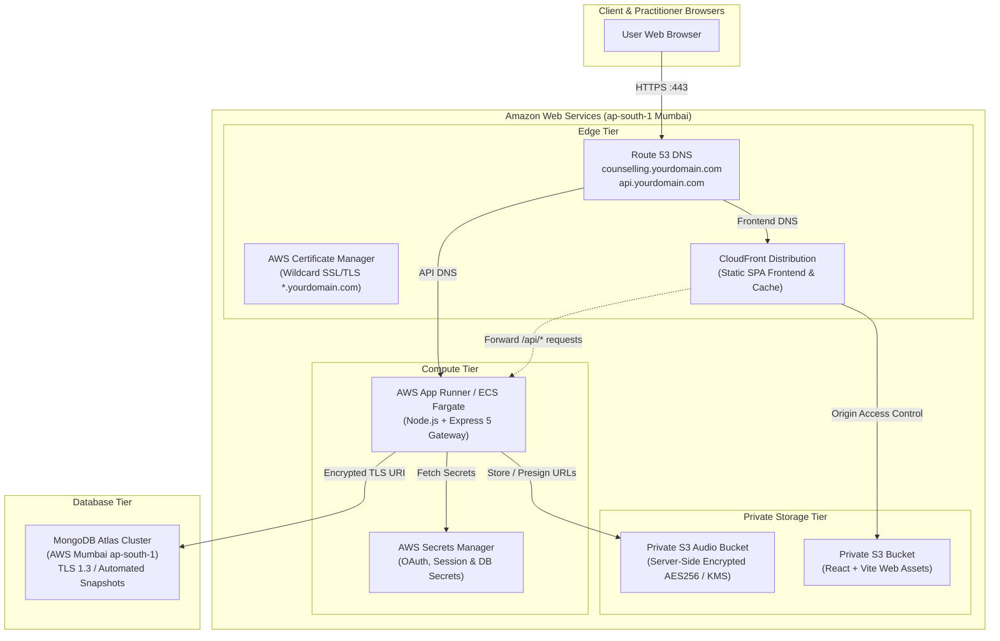

# AWS Cloud Production Deployment Guide
**System:** Counselling Management Portal (Verdant Mind)  
**Target Region:** AWS Mumbai (`ap-south-1`)  
**Architecture:** Highly Available, Containerized Microservice + Secure CloudFront CDN + Atlas TLS

---

## 1. Cloud Architecture Blueprint



---

## 2. Infrastructure Prerequisites

1. An active **AWS Account** with permissions for IAM, S3, CloudFront, Route 53, ACM, and App Runner/ECS.
2. An active **MongoDB Atlas** account (AWS `ap-south-1` region cluster recommended).
3. A registered **Custom Domain** (e.g. `yourdomain.com`) managed in AWS Route 53 or your DNS registrar (Cloudflare, GoDaddy, Namecheap).
4. AWS CLI installed and configured:
   ```bash
   aws configure --region ap-south-1
   ```

---

## 3. Step-by-Step Deployment Procedure

### Step 3.1: Provision MongoDB Atlas Cluster (Mumbai ap-south-1)
1. In MongoDB Atlas, create a new cluster in **AWS / ap-south-1 (Mumbai)**.
2. In **Network Access**, add the IP of your App Runner service or enable VPC peering / IP Access list.
3. In **Database Access**, create a dedicated database user:
   - Username: `counselling_app_user`
   - Role: `readWrite` on `counselling_production`
4. Copy the connection string:
   ```
   mongodb+srv://counselling_app_user:<password>@cluster0.mongodb.net/counselling_production?retryWrites=true&w=majority&appName=counselling
   ```

### Step 3.2: Create Private S3 Audio Recording Bucket
1. Create the bucket with server-side encryption and public access blocking enabled:
   ```bash
   aws s3api create-bucket \
     --bucket counselling-recordings-private-prod \
     --region ap-south-1 \
     --create-bucket-configuration LocationConstraint=ap-south-1

   # Enforce complete Block Public Access
   aws s3api put-public-access-block \
     --bucket counselling-recordings-private-prod \
     --public-access-block-configuration "BlockPublicAcls=true,IgnorePublicAcls=true,BlockPublicPolicy=true,RestrictPublicBuckets=true"

   # Enable AES256 Server-Side Default Encryption
   aws s3api put-bucket-encryption \
     --bucket counselling-recordings-private-prod \
     --server-side-encryption-configuration '{
       "Rules": [{
         "ApplyServerSideEncryptionByDefault": {
           "SSEAlgorithm": "AES256"
         }
       }]
     }'
   ```

### Step 3.3: Deploy Backend with AWS App Runner
AWS App Runner offers zero-maintenance auto-scaling Node.js container hosting with built-in HTTPS and custom domain support.

#### Option A: Deploy via GitHub Repository (Direct Source)
1. Push your repository to GitHub.
2. In the AWS Console, open **App Runner** > **Create service**.
3. Source: **Source code repository** > Connect your GitHub account.
4. Repository: Select your counselling repo, branch: `main` or `production-upgrade`.
5. Build settings:
   - Runtime: **Node.js 22** (or **Corretto 21** / **Docker**)
   - Build command: `npm ci && npm run build`
   - Start command: `node server.js`
   - Port: `5000`
6. Environment Variables (Add under Configuration):
   - `NODE_ENV`: `production`
   - `PORT`: `5000`
   - `FRONTEND_URL`: `https://counselling.YOURDOMAIN.com`
   - `API_URL`: `https://api.YOURDOMAIN.com`
   - `MONGODB_URI`: (Your Atlas connection string)
   - `SESSION_SECRET`: (64-character random string)
   - `GOOGLE_CLIENT_ID`: (From Google Cloud Console)
   - `GOOGLE_CLIENT_SECRET`: (From Google Cloud Console)
   - `GOOGLE_CALLBACK_URL`: `https://api.YOURDOMAIN.com/api/auth/google/callback`
   - `AWS_REGION`: `ap-south-1`
   - `AWS_S3_BUCKET`: `counselling-recordings-private-prod`
   - `BOOTSTRAP_ADMIN_EMAIL`: `sabujd880@gmail.com`
   - `BREVO_API_KEY`: (Your Brevo API Key)
   - `SENDER_EMAIL`: `sabujd880@gmail.com`
   - `SENDER_NAME`: `Sabuj Das | Verdant Mind`
   - `GEMINI_API_KEY`: (Your Gemini API Key)
7. Instance Sizing: `1 vCPU, 2 GB Memory` (Autoscaling: min 1, max 5).
8. Click **Create & Deploy**.

#### Option B: Deploy via AWS ECR Container Image
Build and push using Docker:
```bash
# Authenticate Docker to AWS ECR
aws ecr get-login-password --region ap-south-1 | docker login --username AWS --password-stdin <YOUR_AWS_ACCOUNT_ID>.dkr.ecr.ap-south-1.amazonaws.com

# Build production container image
docker build -t counselling-portal:latest .

# Tag and push
docker tag counselling-portal:latest <YOUR_AWS_ACCOUNT_ID>.dkr.ecr.ap-south-1.amazonaws.com/counselling-portal:latest
docker push <YOUR_AWS_ACCOUNT_ID>.dkr.ecr.ap-south-1.amazonaws.com/counselling-portal:latest
```

### Step 3.4: Deploy Frontend to S3 + CloudFront (Static CDN Option)
If deploying the frontend independently to CloudFront:
1. Build the production React bundle:
   ```bash
   npm run build
   ```
2. Upload `dist/` to an S3 bucket:
   ```bash
   aws s3 sync dist/ s3://counselling-frontend-prod/ --delete
   ```
3. Configure a CloudFront distribution pointing to `counselling-frontend-prod` with an Origin Access Control (OAC).
4. Set **Custom Error Response** in CloudFront:
   - HTTP Error Code: `404` and `403`
   - Response Page Path: `/index.html`
   - HTTP Response Code: `200` (Crucial for client-side React SPA routing).

---

## 4. Production Health Verification

Verify deployment health using `curl`:
```bash
# 1. Health check availability API
curl -i https://api.YOURDOMAIN.com/api/availability

# 2. Check security headers & HTTPS certificate
curl -I https://counselling.YOURDOMAIN.com
```
Both requests should return `HTTP/2 200 OK` with valid TLS certificates.

