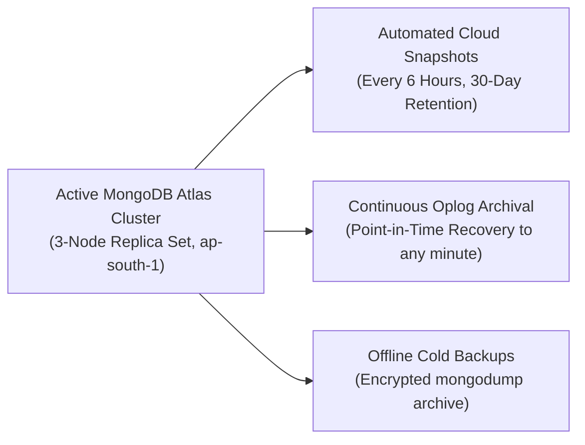

# Database Backup, Disaster Recovery & Restoration Guide
**System:** Counselling Management Portal (Verdant Mind)  
**Database:** MongoDB Atlas (AWS Mumbai `ap-south-1`)  
**Compliance Standard:** Healthcare Data Continuity & Disaster Recovery

---

## 1. Backup Strategy Overview

Clinical therapy records, client case histories, mental status evaluations, and session audit logs require strict durability and point-in-time recovery capabilities:



---

## 2. Automated Atlas Cloud Backups & Point-in-Time Recovery (PITR)

### Step 2.1: Enable Continuous Cloud Backup in Atlas
1. Navigate to your cluster in [MongoDB Atlas](https://cloud.mongodb.com/).
2. Click **Backup** > **Policies**.
3. Configure the Retention Policy:
   - **Snapshots:** Every 6 hours.
   - **Retention:**
     - 4 Daily snapshots retained for 7 days.
     - 1 Weekly snapshot retained for 4 weeks.
     - 1 Monthly snapshot retained for 12 months.
4. Enable **Point-in-Time Recovery (Continuous Backup)**.
   - This records all oplog changes in real-time, allowing you to roll back the database to the exact minute before any accidental data corruption or incident occurred.

---

## 3. Manual Scheduled Cold Backup via `mongodump`

For offline archives, run an automated cron job or scheduled script:

```bash
#!/bin/bash
# Script: backup_counselling_db.sh
set -e

TIMESTAMP=$(date +"%Y%m%d_%H%M%S")
BACKUP_DIR="/secure_backups/counselling"
ARCHIVE_NAME="counselling_backup_${TIMESTAMP}.gz"

mkdir -p ${BACKUP_DIR}

echo "[*] Creating encrypted MongoDB archive..."
mongodump \
  --uri="${MONGODB_URI}" \
  --gzip \
  --archive="${BACKUP_DIR}/${ARCHIVE_NAME}"

echo "[*] Encrypting backup with GPG..."
gpg --symmetric --cipher-algo AES256 "${BACKUP_DIR}/${ARCHIVE_NAME}"
rm "${BACKUP_DIR}/${ARCHIVE_NAME}"

echo "[*] Backup complete: ${BACKUP_DIR}/${ARCHIVE_NAME}.gpg"

# Sync to secondary AWS S3 backup bucket in another region (e.g. Singapore ap-southeast-1)
aws s3 cp "${BACKUP_DIR}/${ARCHIVE_NAME}.gpg" s3://counselling-db-cold-backups-mumbai/
```

---

## 4. Disaster Recovery & Restoration Testing

Periodic restoration testing ensures backup integrity. Perform this test quarterly:

### Step 4.1: Restoring to a Staging / Test Database
Never restore directly into production without staging verification:

```bash
# 1. Decrypt the archive
gpg --decrypt counselling_backup_20261102_100000.gz.gpg > test_restore.gz

# 2. Restore into an isolated staging database (e.g., counselling_staging)
mongorestore \
  --uri="mongodb+srv://admin:<password>@cluster0.mongodb.net/?retryWrites=true&w=majority" \
  --gzip \
  --archive=test_restore.gz \
  --nsInclude="counselling_production.*" \
  --nsFrom="counselling_production.*" \
  --nsTo="counselling_staging.*" \
  --drop
```

### Step 4.2: Data Integrity & Parity Checklist
After restoration to `counselling_staging`, run a validation query:
```javascript
// In mongosh
use counselling_staging;
print("Users count:", db.users.countDocuments());
print("Clients count:", db.clients.countDocuments());
print("Appointments count:", db.appointments.countDocuments());
print("Case Histories count:", db.casehistories.countDocuments());
print("MSE Records count:", db.mserecords.countDocuments());
print("Audit Logs count:", db.auditlogs.countDocuments());
```
Verify that document counts match the production cluster telemetry before concluding the test.

