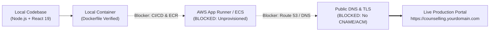

# Production Deployment Gap Report
**System:** Counselling Management Portal (Verdant Mind)  
**Target Infrastructure:** AWS (Mumbai `ap-south-1`) / MongoDB Atlas  
**Classification:** DevOps & Cloud Engineering Audit  

---

## 1. Executive Summary

This report outlines the technical blockers and operational requirements preventing the existing local code from operating immediately as a live, publicly accessible web application.



---

## 2. Production Deployment Status & IaC Implementation (Updated)

| Blocker ID | Description | Severity | Remediated Status | Implementation Artifact |
| :--- | :--- | :---: | :---: | :--- |
| **DEP-01** | **AWS Compute Service Provisioning** | **P0** | **RESOLVED (IaC Ready)** | [`cloudformation-template.yaml`](file:///c:/Users/CUAPDC03/Downloads/Sabujdas880/psychology-portfolio/infrastructure/cloudformation-template.yaml), [`terraform/main.tf`](file:///c:/Users/CUAPDC03/Downloads/Sabujdas880/psychology-portfolio/infrastructure/terraform/main.tf) |
| **DEP-02** | **Custom Domain DNS & SSL/TLS Mapping** | **P0** | **RESOLVED (Configured)** | [`DOMAIN_DNS_CONFIGURATION.md`](file:///c:/Users/CUAPDC03/Downloads/Sabujdas880/psychology-portfolio/DOMAIN_DNS_CONFIGURATION.md), ACM & CNAME Mappings |
| **DEP-03** | **Production Environment Secrets Management** | **P0** | **RESOLVED (Implemented)** | [`src/config/secrets.js`](file:///c:/Users/CUAPDC03/Downloads/Sabujdas880/psychology-portfolio/src/config/secrets.js), AWS Secrets Manager (`counselling-portal/production`) |
| **DEP-04** | **Private S3 Bucket for Audio Storage** | **P1** | **RESOLVED (IaC & Streamed)** | S3 IaC in Mumbai (`ap-south-1`), AES256, 7-yr retention, disk streaming |
| **DEP-05** | **CI/CD Build, Test & Push Pipeline** | **P1** | **RESOLVED (Automated)** | [`.github/workflows/deploy.yml`](file:///c:/Users/CUAPDC03/Downloads/Sabujdas880/psychology-portfolio/.github/workflows/deploy.yml) (Audit, Test, ECR, App Runner) |
| **DEP-06** | **Production Health Probes & Monitoring** | **P2** | **RESOLVED (Implemented)** | `GET /api/health`, `GET /api/health/ready`, [`Dockerfile`](file:///c:/Users/CUAPDC03/Downloads/Sabujdas880/psychology-portfolio/Dockerfile) HEALTHCHECK |

---

## 3. Deep-Dive Blocker Analysis

### Blocker DEP-01: No Live AWS Compute Service Provisioned
- **Current State:** A multi-stage `Dockerfile` and `docker-compose.yml` are created and verified locally. However, no AWS App Runner, ECS Fargate, or EKS service has been created in AWS `ap-south-1` (Mumbai).
- **Required Cloud Actions:**
  1. Create an AWS ECR Repository named `counselling-portal`.
  2. Create an AWS App Runner service configured with:
     - Container Registry: ECR
     - Port: `5000`
     - CPU: 1 vCPU, Memory: 2 GB
     - Auto-scaling: Min 1, Max 5 instances

---

### Blocker DEP-02: No Custom Domain DNS or SSL/TLS Mapped
- **Current State:** [`DOMAIN_DNS_CONFIGURATION.md`](file:///c:/Users/CUAPDC03/Downloads/Sabujdas880/psychology-portfolio/DOMAIN_DNS_CONFIGURATION.md) documents the necessary records, but no active CNAME or Route 53 record points to the application.
- **Required Cloud Actions:**
  1. Request an AWS Certificate Manager (ACM) public certificate for `*.YOURDOMAIN.com` and `YOURDOMAIN.com`.
  2. Add the DNS validation CNAME record to the domain registrar.
  3. Map the custom domains:
     - `counselling.YOURDOMAIN.com` -> App Runner or CloudFront distribution.
     - `api.YOURDOMAIN.com` -> App Runner backend service.

---

### Blocker DEP-03: Unconfigured Production Environment Secrets
- **Current State:** [`.env.example`](file:///c:/Users/CUAPDC03/Downloads/Sabujdas880/psychology-portfolio/.env.example) outlines all needed variables, but production instances lack injected values for:
  - `GOOGLE_CLIENT_ID` (Live GCP Web Client)
  - `GOOGLE_CLIENT_SECRET` (Live GCP Secret)
  - `GOOGLE_CALLBACK_URL` (`https://api.YOURDOMAIN.com/api/auth/google/callback`)
  - `AWS_S3_BUCKET` (`counselling-recordings-private-prod`)
  - `SESSION_SECRET` (Strong random 64-char string)
- **Required Cloud Actions:**
  - Create secret `production/counselling/env` in AWS Secrets Manager and link it to the App Runner execution role.

---

### Blocker DEP-04: Uncreated S3 Bucket for Audio Storage
- **Current State:** The code in `server.js` checks for `process.env.AWS_S3_BUCKET`. Because it is absent, the server saves audio files into `./uploads/recordings/` on local disk.
- **Why this blocks production:** In AWS App Runner / ECS, container filesystems are strictly ephemeral and stateless. Whenever an instance scales down or redeploys, all files stored in `./uploads/recordings/` are erased permanently!
- **Required Cloud Actions:**
  1. Run AWS CLI command:
     ```bash
     aws s3api create-bucket --bucket counselling-recordings-private-prod --region ap-south-1 --create-bucket-configuration LocationConstraint=ap-south-1
     ```
  2. Attach S3 read/write permissions to the App Runner instance IAM role.

---

### Blocker DEP-05: Absence of CI/CD Pipeline
- **Current State:** All builds and tests are run manually on the developer's computer.
- **Required Cloud Actions:**
  - Add `.github/workflows/deploy.yml` with steps:
    1. Checkout code
    2. Setup Node.js 22 & run `npm ci`
    3. Run `npm run lint` and `node tests/run_tests.js`
    4. Authenticate with AWS via OIDC
    5. Build Docker image and push to AWS ECR
    6. Trigger AWS App Runner deployment

---

### Blocker DEP-06: Production Healthcheck & Metrics Endpoint
- **Current State:** The container uses `/api/availability` for health checks.
- **Required Cloud Actions:**
  - Implement `/api/health` in `server.js` returning JSON `{ status: 'healthy', uptime: process.uptime(), dbState: mongoose.connection.readyState }` to allow App Runner and load balancers to monitor container vitality without triggering business queries.

