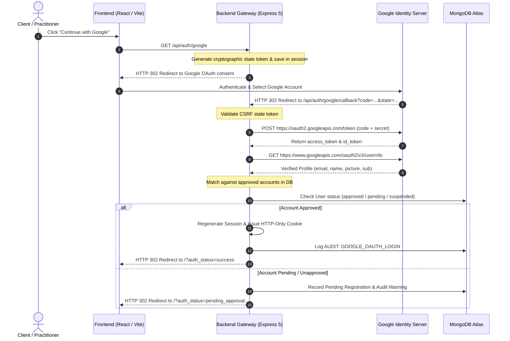

# Google OAuth 2.0 Production Setup Guide
**Project:** Counselling Management Portal (Verdant Mind)  
**Security Standard:** Server-Side Authorization Code Grant Flow (RFC 6749)

---

## 1. Overview & Security Architecture

The Counselling Management Portal integrates Google OAuth 2.0 using a server-side authorization code grant flow. Sensitive credentials (`GOOGLE_CLIENT_SECRET`) never touch the frontend or client browsers. 



---

## 2. Google Cloud Console Configuration Steps

### Step 2.1: Create or Select Google Cloud Project
1. Navigate to the [Google Cloud Console](https://console.cloud.google.com/).
2. Click the project dropdown in the top bar and click **New Project**.
3. Name your project: `Verdant-Mind-Counselling` (or your clinic name).
4. Click **Create**.

### Step 2.2: Configure the OAuth Consent Screen
1. In the left-hand navigation sidebar, go to **APIs & Services** > **OAuth consent screen**.
2. Select User Type:
   - **Internal**: If your clinic uses Google Workspace (recommended for enterprise medical practices).
   - **External**: If patients or external counsellors sign in using standard `@gmail.com` accounts.
3. Click **Create**.
4. Fill in the App Information:
   - **App name**: `Verdant Mind Counselling Portal`
   - **User support email**: `sabujd880@gmail.com`
   - **App logo**: Optional (upload practice emblem)
   - **Application home page**: `https://counselling.YOURDOMAIN.com`
   - **Developer contact information**: `sabujd880@gmail.com`
5. Click **Save and Continue**.
6. **Scopes**: Click **Add or Remove Scopes** and select:
   - `.../auth/userinfo.email` (See your primary Google Account email address)
   - `.../auth/userinfo.profile` (See your personal info, including any personal info you've made publicly available)
   - `openid` (Associate you with your personal info on Google)
7. Click **Save and Continue** and complete the wizard.

### Step 2.3: Create OAuth 2.0 Client Credentials
1. Go to **APIs & Services** > **Credentials**.
2. Click **+ Create Credentials** at the top and select **OAuth client ID**.
3. **Application type**: Select **Web application**.
4. **Name**: `Verdant Mind Web Client`.
5. **Authorized JavaScript origins**:
   - Local Development: `http://localhost:5173`, `http://localhost:5000`
   - Production: `https://counselling.YOURDOMAIN.com`, `https://api.YOURDOMAIN.com`
6. **Authorized redirect URIs**:
   - Local Development: `http://localhost:5000/api/auth/google/callback`
   - Production: `https://api.YOURDOMAIN.com/api/auth/google/callback`
7. Click **Create**.
8. A modal appears displaying your **Client ID** and **Client Secret**.
   - Copy these values immediately.
   - Store them securely in AWS Secrets Manager or your local `.env`.

---

## 3. Environment Variable Binding

Configure your server environment with the acquired credentials:

```bash
GOOGLE_CLIENT_ID=1092837465019-abcdef123456789.apps.googleusercontent.com
GOOGLE_CLIENT_SECRET=GOCSPX-SampleSecretKey9876543210
GOOGLE_CALLBACK_URL=https://api.YOURDOMAIN.com/api/auth/google/callback
BOOTSTRAP_ADMIN_EMAIL=sabujd880@gmail.com
```

> [!IMPORTANT]
> **No Secrets in Frontend:** The `GOOGLE_CLIENT_SECRET` must **never** be exposed in React frontend code or Vite variables (`VITE_*`). It is strictly read on the Express backend server.

---

## 4. API Endpoints Specification

| Endpoint | Method | Purpose | Authentication |
| :--- | :--- | :--- | :--- |
| `/api/auth/google` | `GET` | Generates random CSRF state, stores in session, redirects browser to Google consent screen | Public |
| `/api/auth/google/callback` | `GET` | Validates CSRF state, exchanges auth code for Google tokens, matches user against approved DB records | Public (OAuth callback) |
| `/api/auth/me` | `GET` | Returns active user profile, permissions, and assigned clients from session | Cookie Session |
| `/api/auth/logout` | `POST` | Invalidates server session, writes audit log, clears session cookie | Cookie Session |

---

## 5. Security & Account Matching Logic

1. **Unapproved Account Mitigation:**
   - Any Google user signing in for the first time who is **not** pre-approved or invited by an Administrator will be registered with role `Viewer` and status `pending`.
   - Access to clinical records, appointments, and audio logs is **strictly denied** until a Super Admin or Administrator approves the account in the Admin Governance panel.
2. **Initial Bootstrap Admin:**
   - The user matching `BOOTSTRAP_ADMIN_EMAIL` (`sabujd880@gmail.com`) is automatically provisioned as `Super Admin` upon first login or server startup.
3. **Session Revocation:**
   - If an Administrator clicks "Invalidate Sessions" or changes account status to "suspended", all active sessions are revoked instantly.

