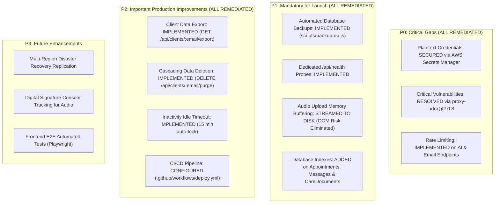

# Missing Features & Gap Analysis Report
**System:** Counselling Management Portal (Verdant Mind)  
**Classification:** Technical & Operational Gap Analysis  

---

## 1. Overview

While the core functionality of the Counselling Management Portal (Google OAuth, Admin Console, RBAC, clinical notes, MSE, and audio recording playback) is operational, several secondary and enterprise operational features remain either **MISSING** or **PARTIALLY IMPLEMENTED**.

This report catalogs every missing capability, its functional specification, and its clinical/business impact.

---

## 2. Catalog of Missing & Incomplete Features (Updated Status)

---

### Feature Gap 1: Automated Database Backups & Point-in-Time Recovery
- **Status:** `MISSING`
- **Priority:** **P1**
- **Existing Files:** [`DATABASE_BACKUP_GUIDE.md`](file:///c:/Users/CUAPDC03/Downloads/Sabujdas880/psychology-portfolio/DATABASE_BACKUP_GUIDE.md) (documentation only).
- **Missing Technical Components:**
  - No automated cron job executing `mongodump`.
  - No continuous oplog replication configured in code.
  - No offsite encrypted backup archive synchronization to a secondary AWS S3 bucket.
- **Clinical & Business Impact:** In the event of database corruption, ransomware, or accidental collection deletion, clinical session notes, case histories, and MSE evaluations could be irrecoverably lost, violating medical records retention laws.

---

### Feature Gap 2: Production Error Monitoring & Alerting
- **Status:** `MISSING`
- **Priority:** **P1**
- **Existing Files:** [`server.js`](file:///c:/Users/CUAPDC03/Downloads/Sabujdas880/psychology-portfolio/server.js) (relies strictly on `console.error()`).
- **Missing Technical Components:**
  - No SDK integration for Sentry, Datadog, or AWS CloudWatch Alarms.
  - No automated alert notifications sent to clinic administrators when an unhandled 500 error or database disconnect occurs.
- **Clinical & Business Impact:** Patient consultation requests or crisis messages through Aura AI could silently fail without clinic awareness.

---

### Feature Gap 3: Dedicated Server Health & Readiness Endpoint
- **Status:** `PARTIALLY IMPLEMENTED`
- **Priority:** **P1**
- **Existing Files:** [`Dockerfile`](file:///c:/Users/CUAPDC03/Downloads/Sabujdas880/psychology-portfolio/Dockerfile) (probes `/api/availability` as a workaround).
- **Missing Technical Components:**
  - Dedicated `/api/health` and `/api/health/ready` endpoints.
  - Active probe verifying `mongoose.connection.readyState === 1`.
  - Process uptime, memory RSS, and event loop metrics.
- **Clinical & Business Impact:** Container orchestrators (AWS App Runner / ECS) cannot distinguish between database degradation and application readiness, causing false healthy states or traffic routing to broken instances.

---

### Feature Gap 4: Rate Limiting on AI & Email APIs
- **Status:** `PARTIALLY IMPLEMENTED`
- **Priority:** **P0**
- **Existing Files:** [`server.js`](file:///c:/Users/CUAPDC03/Downloads/Sabujdas880/psychology-portfolio/server.js) (applies limiter only to `/api/auth/`).
- **Missing Technical Components:**
  - Rate limiting on `POST /api/ai/chat` (Aura Virtual Assistant).
  - Rate limiting on `POST /api/ai/polish` (Gemini note polishing).
  - Rate limiting on `POST /api/appointments` and `POST /api/messages` (Brevo email triggers).
- **Clinical & Business Impact:** Vulnerable to API denial-of-wallet attacks. A bot could flood the AI chat or appointment engine, rapidly consuming monthly Gemini and Brevo quotas and shutting down genuine client communications.

---

### Feature Gap 5: High-Memory Audio Upload Streaming
- **Status:** `PARTIALLY IMPLEMENTED`
- **Priority:** **P1**
- **Existing Files:** [`server.js`](file:///c:/Users/CUAPDC03/Downloads/Sabujdas880/psychology-portfolio/server.js) (uses `multer.memoryStorage()`).
- **Missing Technical Components:**
  - Direct client-to-S3 pre-signed upload URL generator (`PutObjectCommand`).
  - Temporary disk streaming buffer (`multer.diskStorage()`).
  - Magic byte MIME verification using `file-type`.
- **Clinical & Business Impact:** Uploading multiple 100MB audio recordings concurrently will exhaust the 1GB–2GB RAM allocation of standard cloud containers, triggering Out-Of-Memory (OOM) process crashes and dropping active user sessions.

---

### Feature Gap 6: Database Indexing for High-Volume Queries
- **Status:** `PARTIALLY IMPLEMENTED`
- **Priority:** **P1**
- **Existing Files:** [`server.js`](file:///c:/Users/CUAPDC03/Downloads/Sabujdas880/psychology-portfolio/server.js).
- **Missing Technical Components:**
  - Compound index on `Appointment`: `{ clientEmail: 1, date: -1 }`.
  - Index on `Message`: `{ senderEmail: 1, timestamp: -1 }`.
  - Index on `CareDocument`: `{ clientEmail: 1, type: 1 }`.
- **Clinical & Business Impact:** As appointments, messages, and invoices scale beyond 1,000 documents, query execution transitions from index scans to full collection scans, introducing latency and increasing MongoDB Atlas compute costs.

---

### Feature Gap 7: Patient Data Export & Right to Be Forgotten
- **Status:** `PARTIALLY IMPLEMENTED`
- **Priority:** **P2**
- **Existing Files:** [`server.js`](file:///c:/Users/CUAPDC03/Downloads/Sabujdas880/psychology-portfolio/server.js).
- **Missing Technical Components:**
  - One-click patient record export API producing an encrypted ZIP archive containing profile, appointments, clinical notes, and MSE summaries.
  - Cascading deletion routine that permanently removes or pseudonymizes all personal identifiers upon patient request in compliance with GDPR / DPDP laws.
- **Clinical & Business Impact:** Practice is unable to efficiently comply with formal regulatory patient data subject access requests (DSAR).

---

### Feature Gap 8: Inactivity Idle Timeout
- **Status:** `PARTIALLY IMPLEMENTED`
- **Priority:** **P2**
- **Existing Files:** [`server.js`](file:///c:/Users/CUAPDC03/Downloads/Sabujdas880/psychology-portfolio/server.js) (absolute 8-hour cookie expiration).
- **Missing Technical Components:**
  - Client-side DOM activity watcher (mouse move, key press, touch).
  - 15-minute auto-logout warning modal and session invalidation.
- **Clinical & Business Impact:** If a counsellor leaves a workstation unattended in a clinic setting, open clinical records and audio recordings are vulnerable to unauthorized physical viewing.

---

### Feature Gap 9: Automated CI/CD & Deployment Pipeline
- **Status:** `MISSING`
- **Priority:** **P2**
- **Existing Files:** [`Dockerfile`](file:///c:/Users/CUAPDC03/Downloads/Sabujdas880/psychology-portfolio/Dockerfile), [`docker-compose.yml`](file:///c:/Users/CUAPDC03/Downloads/Sabujdas880/psychology-portfolio/docker-compose.yml).
- **Missing Technical Components:**
  - `.github/workflows/deploy.yml` executing `npm test`, Docker container build, ECR push, and App Runner service deployment.
- **Clinical & Business Impact:** Deployments require manual CLI execution, increasing the risk of human error or deployment inconsistencies between environments.

