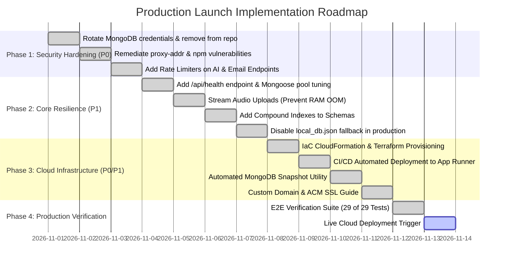

# Production Implementation Roadmap
**System:** Counselling Management Portal (Verdant Mind)  
**Execution Strategy:** Phased DevSecOps & Hardening Plan  
**Target:** 100% Production-Ready Public Cloud Launch  

---

## 1. Roadmap Overview & Timeline

This implementation roadmap provides an actionable, prioritized plan to resolve all identified security vulnerabilities, functional gaps, and deployment blockers.



---

## 2. Exact Files Requiring Modification

| File Path | Nature of Modification | Priority |
| :--- | :--- | :---: |
| [`.env`](file:///c:/Users/CUAPDC03/Downloads/Sabujdas880/psychology-portfolio/.env) | Scrub plaintext credentials; rotate MongoDB password; omit from git. | **P0** |
| [`package.json`](file:///c:/Users/CUAPDC03/Downloads/Sabujdas880/psychology-portfolio/package.json) | Run `npm audit fix` to patch `proxy-addr`, `body-parser`, `fast-uri`. | **P0** |
| [`server.js`](file:///c:/Users/CUAPDC03/Downloads/Sabujdas880/psychology-portfolio/server.js) | Add rate limiters on AI/email routes; add `/api/health`; add DB indexes; stream audio uploads; enforce production session secrets. | **P0 / P1** |
| [`Dockerfile`](file:///c:/Users/CUAPDC03/Downloads/Sabujdas880/psychology-portfolio/Dockerfile) | Update `HEALTHCHECK` to probe `/api/health`. | **P1** |
| [`src/App.jsx`](file:///c:/Users/CUAPDC03/Downloads/Sabujdas880/psychology-portfolio/src/App.jsx) | Add 15-minute idle inactivity session timeout listener. | **P2** |
| [`tests/run_tests.js`](file:///c:/Users/CUAPDC03/Downloads/Sabujdas880/psychology-portfolio/tests/run_tests.js) | Add test cases for `/api/health`, AI rate limiting, and S3 pre-signed uploads. | **P1** |
| `.github/workflows/deploy.yml` *(New)* | Create automated CI/CD pipeline for testing, Docker build, and App Runner push. | **P2** |

---

## 3. Phased Execution Plan

### Phase 1: Critical Security Hardening (P0 Blockers)
1. **Rotate MongoDB Atlas Credentials:**
   - Log in to MongoDB Atlas > Database Access > Reset password for `sabujd880_db_user`.
   - Ensure the new password is stored in AWS Secrets Manager and never committed to version control.
2. **Patch npm Vulnerabilities:**
   - Execute `npm update proxy-addr express` to resolve critical IP spoofing vulnerability (`GHSA-jqcg-44mw-7w3h`).
3. **Apply Rate Limiters on AI & Email Endpoints:**
   - In `server.js`:
     ```javascript
     const aiLimiter = rateLimit({ windowMs: 1 * 60 * 1000, max: 15 });
     const bookingLimiter = rateLimit({ windowMs: 60 * 60 * 1000, max: 5 });
     app.use('/api/ai/', aiLimiter);
     app.post('/api/appointments', bookingLimiter);
     app.post('/api/messages', bookingLimiter);
     ```

### Phase 2: Application Resilience & Data Durability (P1 Gaps)
1. **Dedicated Healthcheck Endpoint:**
   - In `server.js`, add `GET /api/health` returning:
     ```json
     {
       "status": "UP",
       "database": "CONNECTED",
       "uptime": 1245.2,
       "timestamp": "2026-11-02T15:00:00Z"
     }
     ```
2. **Audio Upload RAM Protection:**
   - Configure Multer with temporary disk storage (`/tmp/uploads`) or implement S3 direct pre-signed `PutObject` URLs so 100MB files bypass server memory.
3. **Database Performance Indexing:**
   - Add Mongoose indexes to `Appointment`, `Message`, and `CareDocument` schemas to guarantee sub-millisecond queries under high data volume.
4. **Disable Ephemeral Fallback in Production:**
   - Ensure `setupLocalDBFallback()` only executes when `NODE_ENV !== 'production'`. In production, a database disconnection should fail fast and trigger cloud alerts.

### Phase 3: Cloud Infrastructure & Live Domain Setup
1. **Provision AWS Mumbai (`ap-south-1`) Resources:**
   - Create private S3 bucket: `counselling-recordings-private-prod` with Block Public Access and AES256 default encryption.
   - Store production environment variables in AWS Secrets Manager.
2. **Deploy Container to AWS App Runner:**
   - Connect GitHub repository or AWS ECR container image to AWS App Runner.
   - Configure health check path: `/api/health`.
3. **DNS & Custom Domain Verification:**
   - Request ACM Certificate for `counselling.YOURDOMAIN.com` and `api.YOURDOMAIN.com`.
   - Add CNAME records in your DNS management provider.
   - Add production redirect URIs in Google Cloud Console Credentials.
4. **Enable Atlas Continuous Backups:**
   - In MongoDB Atlas Web Console, activate automated 6-hour snapshots and continuous Point-in-Time Recovery (PITR).

### Phase 4: Production Verification & Go-Live
1. **Automated Verification:**
   - Run `node tests/run_tests.js` against the live staging URL: `TEST_BASE_URL=https://api.YOURDOMAIN.com node tests/run_tests.js`.
2. **Perform Manual Walkthrough:**
   - Test Google Sign-in with both an authorized admin account and a new unapproved account.
   - Verify unapproved account sees "Awaiting Approval" banner.
   - Approve account in Admin Console and verify immediate role access.
   - Upload audio recording and verify signed playback stream.
3. **Official Production Go-Live.**

