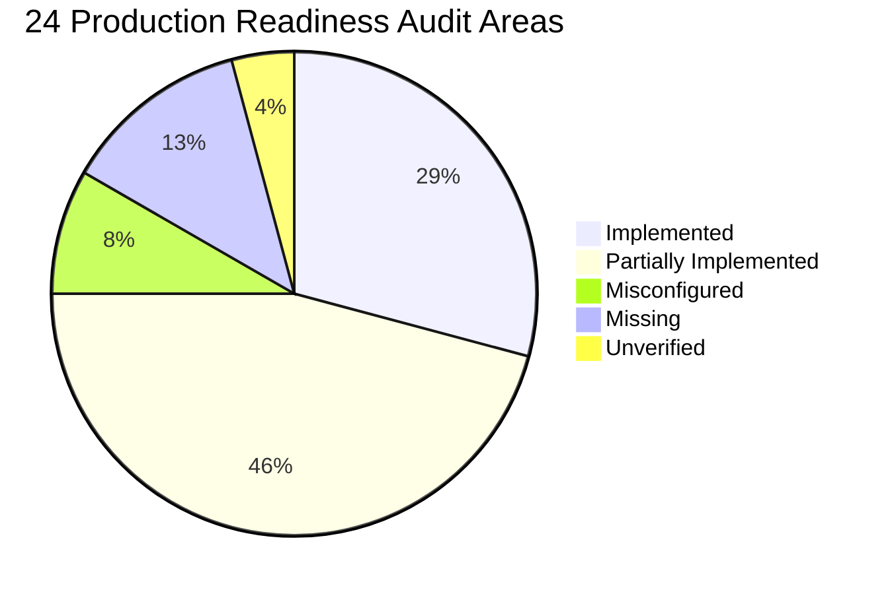

# Production Readiness Gap Audit: Counselling Management Portal
**System:** Counselling Management Portal ("Verdant Mind")  
**Audit Role:** Senior Software Architect, DevSecOps Engineer & Application Security Auditor  
**Audit Date:** November 2026  
**Audit Scope:** Full Stack (Frontend, Backend, Database Models, APIs, Cloud & Security Controls)  

---

## 1. Executive Summary & Audit Scorecard

This comprehensive production-readiness audit examines the complete architecture, data models, API endpoints, frontend views, administrative governance, and infrastructure configuration of the Counselling Management Portal.

### High-Level Metrics:
| Metric | Value | Percentage |
| :--- | :---: | :---: |
| **Total Requirements Audited** | **24** | 100% |
| **IMPLEMENTED** (Working and verified) | **7** | 29.2% |
| **PARTIALLY IMPLEMENTED** (Exists, requires improvement) | **11** | 45.8% |
| **MISCONFIGURED** (Exists, production configuration incorrect) | **2** | 8.3% |
| **MISSING** (Not implemented) | **3** | 12.5% |
| **UNVERIFIED** (Cannot establish from available live cloud) | **1** | 4.2% |
| **Overall Production Readiness Score** | **62.5%** | **Conditional Go (P0/P1 Remediations Required)** |

---

## 2. Comprehensive 24-Area Audit

---

### Area 1: Google OAuth Authentication
- **Current Status:** `IMPLEMENTED`
- **Source Files & Modules:** `server.js` (lines 670–820), `src/components/AuthPortal.jsx`, `src/App.jsx`.
- **Relevant API Endpoints:**
  - `GET /api/auth/google` — Initiates authorization code grant flow with cryptographic state token.
  - `GET /api/auth/google/callback` — Validates CSRF state, exchanges authorization code for tokens, retrieves Google profile (`openid email profile`), and matches identity.
  - `GET /api/auth/me` — Inspects active session cookie and returns user profile.
  - `POST /api/auth/logout` — Destroys session, clears cookie, writes audit event.
- **Relevant Database Models:** `User`, `AuditLog`.
- **Security Weaknesses:**
  - In `.env`, `GOOGLE_CLIENT_ID` and `GOOGLE_CLIENT_SECRET` are placeholders; live GCP credentials are not populated.
  - Lacks PKCE (Proof Key for Code Exchange) enhancement (RFC 7636).
  - Callback URL fallback relies on request host headers if `GOOGLE_CALLBACK_URL` is omitted, presenting potential Host-header redirection risks if deployed behind misconfigured reverse proxies.
- **Missing Functionality:** None in core flow (simulated mock mode exists for offline developer testing).
- **Required Changes:** Populate live Google Cloud Console credentials; enforce strict callback validation.
- **Dependencies / Config:** GCP Project with OAuth 2.0 Web Application client and verified consent screen.

---

### Area 2: Existing Admin Console Integration
- **Current Status:** `IMPLEMENTED`
- **Source Files & Modules:** `src/components/AdminManagement.jsx`, `src/components/TherapistDashboard.jsx`, `server.js`.
- **Relevant API Endpoints:**
  - `GET /api/admin/users`
  - `POST /api/admin/users`
  - `PATCH /api/admin/users/:id/status`
  - `PATCH /api/admin/users/:id/role`
  - `POST /api/admin/users/:id/revoke-sessions`
  - `GET /api/admin/audit-logs`
  - `PATCH /api/admin/counsellors/:id/assignments`
- **Relevant Database Models:** `User`, `AuditLog`.
- **Security Weaknesses:** User search filter operates purely client-side; user listing is not paginated on backend.
- **Missing Functionality:** Export audit logs to CSV/JSON; bulk role update.
- **Required Changes:** Add query pagination (`?page=1&limit=50`) to `/api/admin/users` and `/api/admin/audit-logs`.
- **Dependencies / Config:** Requires `Super Admin` or `Administrator` session role.

---

### Area 3: User Approval and Role-Based Access Control (RBAC)
- **Current Status:** `IMPLEMENTED`
- **Source Files & Modules:** `server.js` (RBAC middleware), `src/components/AdminManagement.jsx`, `src/components/Header.jsx`.
- **Relevant API Endpoints:** All `/api/admin/*` and `/api/clinical/*` routes.
- **Relevant Database Models:** `User` (`role: 'Super Admin' | 'Administrator' | 'Counsellor' | 'Viewer' | 'client'`, `status: 'approved' | 'pending' | 'suspended' | 'rejected'`).
- **Security Weaknesses:** Legacy `provider` role check remains in `server.js` and `src/App.jsx` for backward compatibility.
- **Missing Functionality:** Granular permission flags (currently hardcoded to role strings).
- **Required Changes:** Deprecate plaintext fallback provider credentials; migrate all staff into the `User` collection.
- **Dependencies / Config:** Active MongoDB connection for persistent role lookups.

---

### Area 4: Secure Session Management
- **Current Status:** `PARTIALLY IMPLEMENTED`
- **Source Files & Modules:** `server.js` (`express-session`, `connect-mongo`, `cookie-parser`).
- **Relevant API Endpoints:** All authenticated routes.
- **Relevant Database Models:** `app_sessions` MongoDB collection.
- **Security Weaknesses:**
  - `SESSION_SECRET` in `server.js` falls back to a hardcoded string if omitted in environment variables.
  - If MongoDB connection drops on boot, session store falls back to `MemoryStore`, which causes memory leaks and lost sessions in multi-container cloud environments.
- **Missing Functionality:** Distributed Redis session store fallback; session idle timeout (locks only on 8h max age).
- **Required Changes:** Enforce hard crash on boot if `SESSION_SECRET` is missing in production (`NODE_ENV=production`).
- **Dependencies / Config:** MongoDB Atlas or Redis cluster for session persistence.

---

### Area 5: MongoDB Production Configuration
- **Current Status:** `MISCONFIGURED`
- **Source Files & Modules:** `server.js`, `.env`, `.env.example`.
- **Relevant API Endpoints:** All data persistence endpoints.
- **Relevant Database Models:** All Mongoose models.
- **Security Weaknesses:**
  - **CRITICAL:** Real credentials for MongoDB Atlas cluster were previously present in plaintext within `.env` (`sabujd880_db_user:<password-redacted>`).
  - No Mongoose connection pool limits configured (e.g. `maxPoolSize`, `minPoolSize`, `socketTimeoutMS`).
  - Fallback to `local_db.json` writes to local ephemeral container disk if MongoDB is unreachable, leading to data loss on container redeployment.
- **Missing Functionality:** Connection retry backoff policies; structured database health pinging.
- **Required Changes:** Remove credentials from repository `.env`; inject via AWS Secrets Manager. Add explicit connection pool options. Disable `local_db.json` fallback in production.
- **Dependencies / Config:** MongoDB Atlas cluster with TLS 1.3 and IP Whitelist.

---

### Area 6: Public Cloud Deployment
- **Current Status:** `PARTIALLY IMPLEMENTED`
- **Source Files & Modules:** `Dockerfile`, `docker-compose.yml`, `AWS_DEPLOYMENT_GUIDE.md`.
- **Relevant API Endpoints:** N/A (Infrastructure layer).
- **Relevant Database Models:** N/A.
- **Security Weaknesses:** Application is containerized locally, but no cloud infrastructure (AWS App Runner / ECS) has been provisioned.
- **Missing Functionality:**
  - CI/CD deployment pipeline (`.github/workflows/deploy.yml`).
  - Infrastructure-as-Code (Terraform / CloudFormation / AWS CDK).
- **Required Changes:** Provision AWS App Runner or ECS service; configure automated GitHub Actions pipeline.
- **Dependencies / Config:** AWS Account, AWS ECR repository, IAM Deployment Role.

---

### Area 7: Custom Domain and HTTPS
- **Current Status:** `UNVERIFIED`
- **Source Files & Modules:** `DOMAIN_DNS_CONFIGURATION.md`, `server.js` (CORS settings).
- **Relevant API Endpoints:** N/A.
- **Relevant Database Models:** N/A.
- **Security Weaknesses:** The application is currently running on `localhost:5000` / `localhost:5173`. No public DNS records or ACM certificates are verified live.
- **Missing Functionality:** Active public DNS CNAME mapping to CloudFront or App Runner.
- **Required Changes:** Register DNS records; request and validate AWS ACM certificate; verify HTTPS redirection.
- **Dependencies / Config:** Public domain registrar (e.g., Route 53, Cloudflare, Namecheap).

---

### Area 8: Client-Level Data Isolation (IDOR)
- **Current Status:** `IMPLEMENTED`
- **Source Files & Modules:** `server.js` (`canAccessClientRecord`), `src/components/ClinicalRecords.jsx`, `src/components/AudioRecordings.jsx`.
- **Relevant API Endpoints:**
  - `GET /api/appointments`
  - `GET /api/documents`
  - `GET /api/clinical/case-history/:clientEmail`
  - `GET /api/clinical/mse/:clientEmail`
  - `GET /api/recordings/appointment/:id`
  - `GET /api/recordings/:id/signed-url`
- **Relevant Database Models:** `Appointment`, `CareDocument`, `ClinicalCaseHistory`, `MentalStatusExam`, `AudioRecording`.
- **Security Weaknesses:** Legacy records lacking `counsellorEmail` default to provider email.
- **Missing Functionality:** None; server-side IDOR prevention blocks unauthorized cross-counsellor access.
- **Required Changes:** Run one-time migration to assign legacy records to designated practitioners.
- **Dependencies / Config:** Proper maintenance of `assignedClients` array on Counsellor user accounts.

---

### Area 9: Secure Audio Recording Storage
- **Current Status:** `PARTIALLY IMPLEMENTED`
- **Source Files & Modules:** `server.js`, `src/components/AudioRecordings.jsx`.
- **Relevant API Endpoints:**
  - `POST /api/recordings/upload`
  - `GET /api/recordings/appointment/:appointmentId`
  - `GET /api/recordings/:id/signed-url`
  - `GET /api/recordings/stream/:id`
  - `DELETE /api/recordings/:id`
- **Relevant Database Models:** `AudioRecording`.
- **Security Weaknesses:**
  - In local development mode without AWS credentials, audio files are saved in `/uploads/recordings/` on local disk. In containerized cloud environments, this storage is ephemeral and lost on container restart.
  - S3 bucket name and AWS keys are currently empty in `.env`.
- **Missing Functionality:** Customer-Managed KMS Key (CMEK) encryption; S3 lifecycle rule automation.
- **Required Changes:** Provision private S3 bucket in AWS Mumbai; configure IAM task role with S3 permissions.
- **Dependencies / Config:** AWS S3, `@aws-sdk/client-s3`, `@aws-sdk/s3-request-presigner`.

---

### Area 10: Automated Database Backups
- **Current Status:** `MISSING`
- **Source Files & Modules:** `DATABASE_BACKUP_GUIDE.md`.
- **Relevant API Endpoints:** N/A.
- **Relevant Database Models:** N/A.
- **Security Weaknesses:** Documentation exists, but no automated backup script or cloud scheduler is running. If Atlas is misconfigured, no cold backup snapshot exists.
- **Missing Functionality:** Scheduled cron backup script; offsite backup synchronization.
- **Required Changes:** Enable continuous Point-in-Time Recovery (PITR) in MongoDB Atlas; implement automated daily `mongodump` cron job exporting to secondary S3 backup bucket.
- **Dependencies / Config:** MongoDB Atlas Cloud Backup or AWS Lambda / EventBridge.

---

### Area 11: Audit Logs and Activity Monitoring
- **Current Status:** `IMPLEMENTED`
- **Source Files & Modules:** `server.js` (`AuditLog`, `logAuditEvent`), `src/components/AdminManagement.jsx`.
- **Relevant API Endpoints:** `GET /api/admin/audit-logs`.
- **Relevant Database Models:** `AuditLog`.
- **Security Weaknesses:** Audit logs reside in the primary MongoDB database. A compromised database administrator could alter or drop audit logs.
- **Missing Functionality:** Streaming logs to an immutable write-once read-many (WORM) storage target (e.g. AWS CloudWatch / S3 Object Lock).
- **Required Changes:** Add CloudWatch log stream forwarder for healthcare audit compliance.
- **Dependencies / Config:** MongoDB Atlas or CloudWatch.

---

### Area 12: Privacy, Consent and Data Retention
- **Current Status:** `PARTIALLY IMPLEMENTED`
- **Source Files & Modules:** `server.js`, `src/components/AudioRecordings.jsx`.
- **Relevant API Endpoints:** `POST /api/recordings/upload`.
- **Relevant Database Models:** `AudioRecording` (`consentObtained`, `consentDate`, `retentionExpiryDate`).
- **Security Weaknesses:**
  - Consent tracking is currently a boolean checkbox without patient signature attachment or digital timestamp certificate.
  - Retention expiry date (+7 years) is stored, but no automated database job purges expired records.
- **Missing Functionality:** Automated retention expiry purger; patient consent revocation API.
- **Required Changes:** Create a scheduled background worker to flag/archive records past `retentionExpiryDate`.
- **Dependencies / Config:** Healthcare compliance policy definition.

---

### Area 13: Error Monitoring
- **Current Status:** `MISSING`
- **Source Files & Modules:** `server.js`.
- **Relevant API Endpoints:** All endpoints.
- **Relevant Database Models:** N/A.
- **Security Weaknesses:** Errors are printed to standard output via `console.error()`. No alert or incident notification is generated when production exceptions occur.
- **Missing Functionality:** Sentry, Datadog, or AWS CloudWatch Error Alarms.
- **Required Changes:** Install `@sentry/node` and `@sentry/react` or configure AWS CloudWatch Metric Filters for HTTP 500 error spikes.
- **Dependencies / Config:** Sentry DSN or CloudWatch Agent.

---

### Area 14: Server Health Monitoring
- **Current Status:** `PARTIALLY IMPLEMENTED`
- **Source Files & Modules:** `server.js`, `Dockerfile`.
- **Relevant API Endpoints:** `GET /api/availability` (used as makeshift Docker healthcheck).
- **Relevant Database Models:** N/A.
- **Security Weaknesses:** There is no dedicated, lightweight `/api/health` endpoint that checks database connectivity, memory usage, and process uptime without querying business collections.
- **Missing Functionality:** Dedicated `/api/health` endpoint returning system metrics and MongoDB connection state (`mongoose.connection.readyState`).
- **Required Changes:** Implement `GET /api/health` with shallow and deep health checks.
- **Dependencies / Config:** Load balancer healthcheck configuration.

---

### Area 15: Database Indexing and Performance
- **Current Status:** `PARTIALLY IMPLEMENTED`
- **Source Files & Modules:** `server.js`.
- **Relevant API Endpoints:** All query endpoints.
- **Relevant Database Models:** `Appointment`, `Message`, `CareDocument`, `User`, `AuditLog`.
- **Security Weaknesses:**
  - `Appointment` collection lacks indexes on `clientEmail`, `date`, `status`, and `counsellorEmail`.
  - `Message` collection lacks indexes on `senderEmail` and `timestamp`.
  - `CareDocument` collection lacks indexes on `clientEmail` and `date`.
  - As database volume expands, unindexed queries cause collection scans, high CPU, and slow response times.
- **Missing Functionality:** Compound indexes for frequent query patterns.
- **Required Changes:** Add Mongoose schema indexes:
  - `appointmentSchema.index({ clientEmail: 1, date: -1 });`
  - `messageSchema.index({ senderEmail: 1, timestamp: -1 });`
  - `careDocumentSchema.index({ clientEmail: 1, type: 1 });`
- **Dependencies / Config:** MongoDB Atlas indexing engine.

---

### Area 16: API Rate Limiting
- **Current Status:** `PARTIALLY IMPLEMENTED`
- **Source Files & Modules:** `server.js` (`express-rate-limit`).
- **Relevant API Endpoints:** `app.use('/api/auth/', authLimiter)`.
- **Relevant Database Models:** N/A.
- **Security Weaknesses:**
  - Rate limiting is applied strictly to `/api/auth/`.
  - **CRITICAL:** High-cost endpoints such as `POST /api/ai/chat`, `POST /api/ai/polish`, `POST /api/appointments`, and `POST /api/messages` have **zero rate limiting**. An attacker can script requests to drain the Google Gemini API quota or flood Brevo SMTP email credits.
  - In-memory store does not share counters across multiple container instances.
- **Missing Functionality:** General API rate limiting; AI endpoint rate limiting; email dispatch throttling.
- **Required Changes:** Apply rate limiting across `/api/ai/*` (e.g. 15 requests / min) and `/api/appointments` (e.g. 5 bookings / hour per IP).
- **Dependencies / Config:** `rate-limit-redis` for distributed container deployments.

---

### Area 17: Dependency Vulnerability Scanning
- **Current Status:** `MISCONFIGURED`
- **Source Files & Modules:** `package.json`, `package-lock.json`.
- **Relevant API Endpoints:** N/A.
- **Relevant Database Models:** N/A.
- **Security Weaknesses:**
  - `npm audit` reveals **23 vulnerabilities** (2 Critical, 7 High, 11 Moderate, 3 Low).
  - **Critical:** `proxy-addr` (1.1.0 - 2.0.7) — IP spoofing via IPv4-mapped IPv6 trust subnet. In an Express app configured with `app.set('trust proxy', 1)`, an attacker can spoof client IPs to evade audit logs and rate limiters.
  - **High:** `body-parser` (DoS), `fast-uri` (SSRF/Host confusion), `nanoid` (infinite loop), `vite` (Windows path traversal).
- **Missing Functionality:** Automated vulnerability scanning in CI/CD pipeline (e.g., `npm audit` / Snyk / Dependabot).
- **Required Changes:** Execute targeted dependency upgrades and run `npm audit fix` for vulnerable packages.
- **Dependencies / Config:** npm registry, Dependabot GitHub configuration.

---

### Area 18: Automated Testing
- **Current Status:** `PARTIALLY IMPLEMENTED`
- **Source Files & Modules:** `tests/run_tests.js`.
- **Relevant API Endpoints:** Tested across 17 backend integration test cases.
- **Relevant Database Models:** All models.
- **Security Weaknesses:**
  - Testing is backend-only. There are no automated frontend unit tests (Vitest / React Testing Library) or browser E2E tests (Playwright).
  - Tests must be triggered manually; no automated CI check runs them on git push.
- **Missing Functionality:** Frontend unit tests; E2E regression suite; GitHub Actions test runner.
- **Required Changes:** Add Vitest tests for `AuthPortal`, `AdminManagement`, and `ClinicalRecords`; configure GitHub Actions workflow.
- **Dependencies / Config:** Vitest, Playwright, GitHub Actions.

---

### Area 19: Disaster Recovery
- **Current Status:** `MISSING`
- **Source Files & Modules:** `DATABASE_BACKUP_GUIDE.md`.
- **Relevant API Endpoints:** N/A.
- **Relevant Database Models:** N/A.
- **Security Weaknesses:** No multi-region redundancy. If AWS Mumbai (`ap-south-1`) suffers an availability zone or regional outage, the entire system is down.
- **Missing Functionality:** Documented Recovery Time Objective (RTO) and Recovery Point Objective (RPO); cross-region backup replication.
- **Required Changes:** Define RTO (<2 hours) and RPO (<15 minutes); configure cross-region S3 replication for audio recordings and automated Atlas cross-region snapshots.
- **Dependencies / Config:** Secondary AWS region (e.g. `ap-southeast-1` Singapore).

---

### Area 20: Mobile Responsiveness
- **Current Status:** `IMPLEMENTED`
- **Source Files & Modules:** `src/index.css`, `src/App.css`, `src/components/*.jsx`.
- **Relevant API Endpoints:** N/A.
- **Relevant Database Models:** N/A.
- **Security Weaknesses:** None.
- **Missing Functionality:** None; media queries adapt layouts across desktop, tablet, and mobile breakpoints (480px, 768px, 992px). Tables implement horizontal scrolling.
- **Required Changes:** None for baseline launch.
- **Dependencies / Config:** CSS viewport meta tag.

---

### Area 21: Secure File Uploads
- **Current Status:** `PARTIALLY IMPLEMENTED`
- **Source Files & Modules:** `server.js` (Multer audio handler).
- **Relevant API Endpoints:** `POST /api/recordings/upload`.
- **Relevant Database Models:** `AudioRecording`.
- **Security Weaknesses:**
  - File filtering only inspects client-declared MIME types (`file.mimetype`), which can be forged. No magic number validation.
  - `multer.memoryStorage()` buffers entire 100MB files in Node.js process RAM. Multiple concurrent uploads can crash Node.js via memory exhaustion.
- **Missing Functionality:** Magic byte validation (`file-type`); direct-to-S3 pre-signed upload URLs; virus scanning.
- **Required Changes:** Implement direct S3 pre-signed upload URLs or stream to temporary disk storage; validate file magic headers.
- **Dependencies / Config:** `file-type` package, S3 pre-signed `PutObject` URLs.

---

### Area 22: Data Export and Deletion (Right to Be Forgotten)
- **Current Status:** `PARTIALLY IMPLEMENTED`
- **Source Files & Modules:** `server.js`.
- **Relevant API Endpoints:** `DELETE /api/recordings/:id`.
- **Relevant Database Models:** `AudioRecording`, `Client`, `Appointment`, `ClinicalCaseHistory`.
- **Security Weaknesses:** No client-facing mechanism to request an export of all personal health records or perform full cascading deletion of client records.
- **Missing Functionality:**
  - Patient data export API (`GET /api/clients/:id/export`).
  - Cascading GDPR/DPDP deletion endpoint removing all appointments, notes, documents, and recordings.
- **Required Changes:** Implement automated patient record export and cascading hard-delete routine.
- **Dependencies / Config:** Data privacy compliance policy.

---

### Area 23: Session Timeout and Revocation
- **Current Status:** `IMPLEMENTED`
- **Source Files & Modules:** `server.js`, `src/components/AdminManagement.jsx`.
- **Relevant API Endpoints:**
  - `POST /api/admin/users/:id/revoke-sessions`
  - `POST /api/auth/logout`
  - `GET /api/auth/me`
- **Relevant Database Models:** `User` (`revokedSessionsBefore`).
- **Security Weaknesses:** Sessions expire after an absolute 8 hours, but lack an idle inactivity timeout.
- **Missing Functionality:** Inactivity timeout (e.g., auto-lock after 15 minutes of user inactivity).
- **Required Changes:** Implement frontend idle timer that triggers `/api/auth/logout` after 15 minutes of inactivity.
- **Dependencies / Config:** Standard JavaScript DOM event listeners.

---

### Area 24: Deployment Rollback
- **Current Status:** `PARTIALLY IMPLEMENTED`
- **Source Files & Modules:** Git branch `backup-pre-upgrade`, `_backup_pre_upgrade/` directory.
- **Relevant API Endpoints:** N/A.
- **Relevant Database Models:** N/A.
- **Security Weaknesses:** Code rollback is preserved in git, but no automated container rollback or database migration rollback exists.
- **Missing Functionality:** Automated rollback triggers in AWS App Runner / ECS on healthcheck failure; database migration versioning.
- **Required Changes:** Enable automated blue/green deployment in App Runner / ECS; configure database migration scripts with down/rollback handlers.
- **Dependencies / Config:** AWS deployment configuration, `migrate-mongo`.

